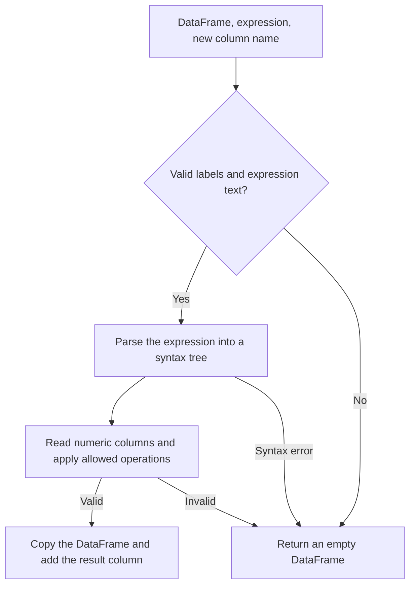

# Virtual Columns and Sales Revenue

A Python and pandas function for calculated columns, used to clean sales data and total revenue by region.

## Run Locally

Requires Python 3.9 or newer. Tested with Python 3.9.6.

```bash
python3 -m venv .venv
source .venv/bin/activate
python -m pip install -r requirements.txt
python pipeline.py
python -m pytest -q
```

The pipeline reads `sales.csv` and writes `revenue_by_region.csv` next to `pipeline.py`.
The source file is unchanged. The output contains `region` and `revenue`, sorted by region.

## Part 1: Calculated Column

`solution.py` exports `add_virtual_column(df, role, new_column)`.
For example, `add_virtual_column(df, "quantity * unit_price - discount", "revenue")`.



Expressions support column names, `+`, `-`, `*`, and parentheses with normal precedence;
numeric constants and unary minus are not supported. Evaluation uses AST, without `eval()`.

- Labels use ASCII letters and underscores; duplicates and overwriting are rejected.
- Referenced columns must be numeric. Expressions are limited to 4096 characters.
- Invalid input returns an empty DataFrame; valid input returns a copy with the new column.

## Part 2: Sales Pipeline

`pipeline.py` cleans the export, calls `add_virtual_column` with `quantity * unit_price - discount`,
then sums revenue by region. Discount applies to the whole line.

### Data and Cleanup

The CSV has **1507 rows** after its first header. Cleanup leaves **1500 sales lines**.
Counts below refer to the source unless noted; problems can overlap.

| Problem or decision | Count | Handling |
| --- | ---: | --- |
| Column naming | 7 names; `Quantity ` has a trailing space | Strip, lowercase, and replace spaces with underscores. |
| Repeated header | 1 row | Remove the row matching the complete header. |
| `TOTAL` summary | 1 row | Remove the aggregate row, including its blank fields. |
| Exact duplicate sales lines | 5 extra copies | Keep one copy. Assume these are repeated export records; keep distinct lines sharing an order ID. |
| Region whitespace or case | 15 rows: 8 whitespace, 10 case, 3 both | Strip and use title case. |
| Thousands separator in quantity | 4 rows | Convert `1 762` to `1762`. |
| Decimal comma in price | 7 rows | Replace with a decimal point. |
| Missing sale price | 4 rows | Use the product's only known price: `21.00` for Printer paper, `89.00` for Keyboard. |
| Empty discount | 963 rows; 959 after deduplication | Set to zero, as specified. |
| Negative quantity | 6 rows | Treat as returns and keep the negative revenue. |

All eight products have one distinct known price. Missing prices with no known price or multiple known prices cause an error.
Large quantities are kept; there is no evidence they are errors. Sale dates are valid ISO dates; dates and product names pass through unchanged.

### Amounts and Validation

Amounts use one unspecified currency. Prices and discounts must be non-negative with at most two decimal places.
`Decimal` converts amounts to integer hundredths for calculation and formats totals with two decimal places.

Invalid columns, numbers or regions stop the pipeline before output is opened.
Regions accept only ASCII letters and single spaces between words.

To prevent `int64` overflow, the sum of `abs(quantity) * price + discount` across the
whole file must not exceed `2**63 - 1` hundredths. This conservative limit can reject
very large files even when individual regional totals fit, including offsetting sales and returns.

## Tests

`python -m pytest -q` runs all tests:

- `test_virtual_column.py`: six supplied tests, unchanged, plus arithmetic, validation and security tests.
- `test_pipeline.py`: cleanup, price recovery, returns, exact amounts, invalid files, overflow and totals for the supplied CSV.

Pipeline tests write to temporary files and leave the source data unchanged.
